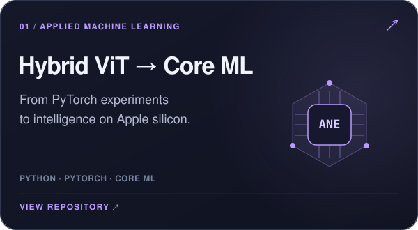
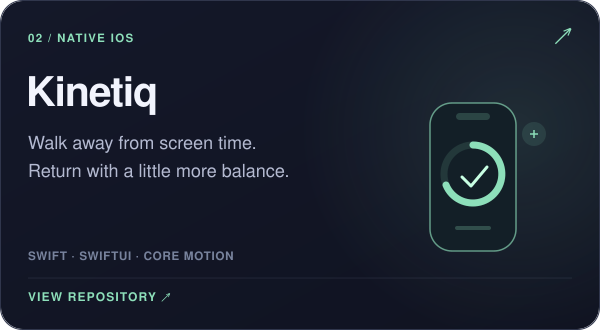
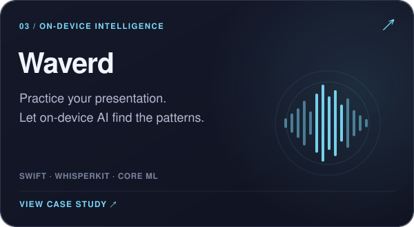
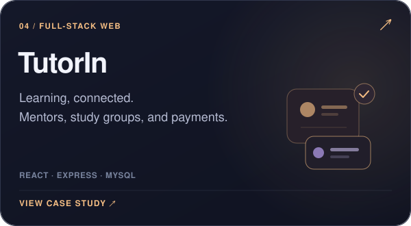
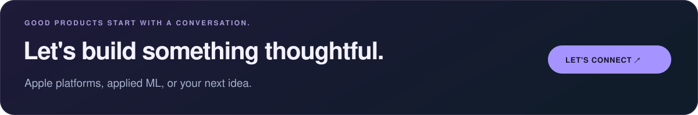

  <a href="https://valentinohartanto.com"><kbd>　↗ EXPLORE PORTFOLIO　</kbd></a> &nbsp;
  <a href="https://www.linkedin.com/in/valentino-hartanto/"><kbd>　LINKEDIN　</kbd></a> &nbsp;
  <a href="https://valentinohartanto.com/notes"><kbd>　READ MY NOTES　</kbd></a>

 

### From research to real products.

I'm **Valentino**, a software engineer building across **Apple platforms, on-device ML, and the web**. I turn experiments into useful products, with care for both the systems underneath and the people using them.

🎓 **Informatics, Telkom University** &nbsp; / &nbsp; 🍎 **Apple Developer Academy @ Infinite Learning · 2026**

 

## Selected work

A few things I've built, from native interactions to intelligence on Apple silicon.

<table>
  <tr>
    <td width="50%"></td>
    <td width="50%"></td>
  </tr>
  <tr>
    <td width="50%"></td>
    <td width="50%"></td>
  </tr>
</table>

↳ Also exploring the softer side of software with **[Postbox, a letter-inspired journaling app](https://valentinohartanto.com/work/postbox)**.

 

## Tools behind the work

  

| Native experiences | Applied intelligence | Connected products |
| :--- | :--- | :--- |
| SwiftUI · SwiftData · Core Motion | Core ML · Computer Vision · scikit-learn | TypeScript · React · Next.js · Express |
| iOS & macOS | On-device inference & model optimization | APIs, databases & full-stack applications |

 

## Research & field notes

**01 / Computer vision**  
[Hybrid CNN–Transformer optimization with Particle Swarm Optimization](https://ieeexplore.ieee.org/abstract/document/11327313) — skin lesion classification.

**02 / Deep learning**  
[EfficientNetV2 with Particle Swarm Optimization](https://doi.org/10.32409/jikstik.24.3.3835) — wheat disease classification.

**03 / Behind the interface**  
[Notes on native products, on-device ML, and experiments →](https://valentinohartanto.com/notes)

 

Built with curiosity. Refined through iteration. &nbsp; / &nbsp; <a href="https://valentinohartanto.com">valentinohartanto.com</a>

